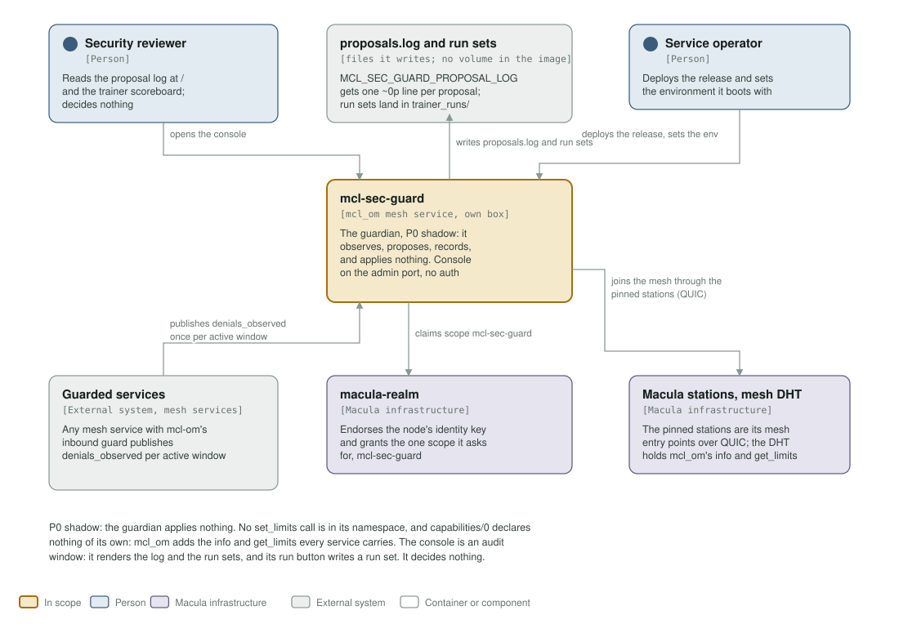
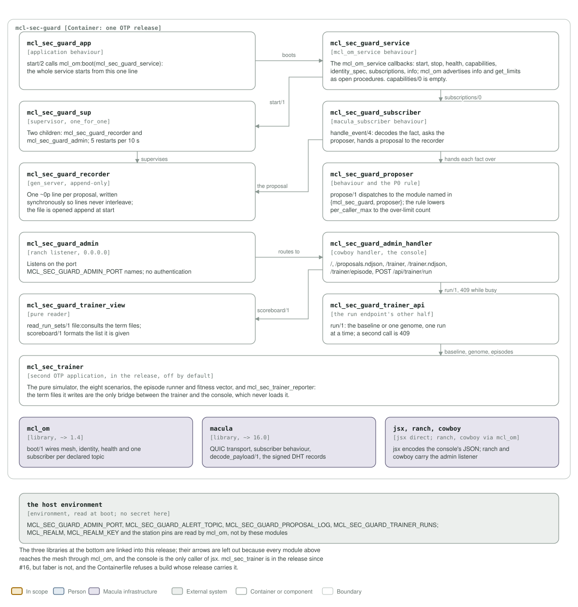

# mcl-sec-guard architecture: C4 model

*This exists so a reader can see what mcl-sec-guard talks to, and what it is made
of, without reading it.*

**Status: P0 shadow, one release in one container.** The service subscribes to
the mesh's `denials_observed` facts, runs a deterministic placeholder rule over
each one, and appends a proposal line to a local file. It announces no
capability of its own, applies nothing, and keeps no store. A second OTP application, the
trainer, ships in the same release and is off by default; the admin console on
the port `MCL_SEC_GUARD_ADMIN_PORT` names (every interface, no auth) renders the
proposal log and the run sets, and its run button writes a run set. The recorder
writes the log; they are the only two writers.

## Level 1: system context

| Element | Kind | Role |
| --- | --- | --- |
| mcl-sec-guard | In scope | One OTP release in one container, an `mcl_om` mesh service on its own box. Subscribes to `denials_observed`, records a proposal per hot window, and serves the console on the port `MCL_SEC_GUARD_ADMIN_PORT` names |
| Security reviewer | Person | Opens `/` for the proposal log and `/trainer` for the scoreboard, and can start an evaluation from the run button. Decides nothing here: P0 has no apply path |
| Service operator | Person | Runs the box, deploys the release, and supplies the realm, key and station pins the release boots with |
| proposals.log and run sets | Files inside the container | `MCL_SEC_GUARD_PROPOSAL_LOG` gets one `~0p` line per proposal; run sets land under `MCL_SEC_GUARD_TRAINER_RUNS`. The image declares no data volume, so both live and die with the container |
| Guarded services | External system, mesh services | Any mesh service carrying `mcl_om`'s inbound guard. It publishes one `denials_observed` fact per window that saw activity |
| macula-realm | Macula infrastructure | Endorses the node's identity key and grants the one scope the service asks for, `mcl-sec-guard` |
| Macula stations, mesh DHT | Macula infrastructure | The pinned stations are its mesh entry points over QUIC. The DHT holds no capability of this service's own, because `capabilities/0` returns `[]`: the only ones advertised are the `info` and `get_limits` mcl_om adds to every service |

The guardian never calls a guarded service back. The relationship is one-way
fact flow: a service publishes what it denied, the guardian proposes a limit
and writes it down, and no `set_limits` call exists anywhere in the P0
namespace. A compromised P0 guardian can write a bad proposal into its own log
and nothing else.

## Level 2: containers and components

| Component | Technology | Responsibility |
| --- | --- | --- |
| `mcl_sec_guard_app` | application behaviour | `start/2` calls `mcl_om:boot(mcl_sec_guard_service)`. The whole service starts from this one line; there is no store to open first |
| `mcl_sec_guard_service` | the `mcl_om_service` behaviour | `info/0`, `start/1`, `stop/1`, `health/0`, `capabilities/0`, `identity_spec/0` and `subscriptions/0`. `capabilities/0` returns `[]` and the identity asks for the `mcl-sec-guard` scope with no actions |
| `mcl_sec_guard_sup` | supervisor, `one_for_one` | Two children, `mcl_sec_guard_recorder` and `mcl_sec_guard_admin`, with 5 restarts per 10 s. The alert subscription is not here: `mcl_om` supervises one subscriber per declared topic |
| `mcl_sec_guard_subscriber` | `macula_subscriber` behaviour | `handle_event/4` decodes the fact, asks the proposer, stamps the verified publisher's node id and sequence onto the proposal, and hands it to the recorder |
| `mcl_sec_guard_proposer` | behaviour, plus the P0 rule | `propose/1` dispatches to the module named in `{mcl_sec_guard, proposer}`. `mcl_sec_guard_proposer_rule` proposes lowering `per_caller_max` to the over-limit count, and nothing else |
| `mcl_sec_guard_recorder` | `gen_server`, append-only | Opens the log append at start and writes one `~0p` line per proposal synchronously, so lines never interleave. It crashes on an unwritable log rather than dropping proposals quietly |
| `mcl_sec_guard_admin` | ranch listener, `0.0.0.0` | Listens on the port `MCL_SEC_GUARD_ADMIN_PORT` names, with no authentication, the dev-fleet posture |
| `mcl_sec_guard_admin_handler` | cowboy handler, the console | `GET /`, `/proposals.ndjson`, `/trainer`, `/trainer.ndjson`, `/trainer/episode`, and `POST /api/trainer/run`; everything else is a 404 |
| `mcl_sec_guard_trainer_view` | pure reader | `read_run_sets/1` `file:consult/1`s the reporter's term files; `scoreboard/1` only formats the list it is handed. It loads no trainer module, which is why the console works with the trainer absent |
| `mcl_sec_guard_trainer_api` | the run endpoint's other half | `run/1` evaluates the baseline or one genome, one run at a time: a second call in flight returns `run_in_progress`, which the handler maps to 409 |
| `mcl_sec_trainer` | second OTP application, in the release, off by default | The pure simulator, the eight scenarios, the episode runner and fitness vector, and `mcl_sec_trainer_reporter`. The term files it writes are the only bridge to the console |
| `mcl_om` | library, `~> 1.4` | `boot/1`: mesh, identity, health, and one supervised subscriber per declared topic |
| `macula` | library, `~> 16.0` | QUIC transport, the subscriber behaviour, `decode_payload/1`, and the signed DHT records |
| `jsx, ranch, cowboy` | libraries, `jsx` declared directly | `jsx` encodes the console's JSON; `ranch` and `cowboy` carry the admin listener |
| the host environment | environment, read at boot | `MCL_SEC_GUARD_ADMIN_PORT`, `MCL_SEC_GUARD_ALERT_TOPIC`, `MCL_SEC_GUARD_PROPOSAL_LOG`, `MCL_SEC_GUARD_TRAINER_RUNS`; `MCL_REALM`, `MCL_REALM_KEY` and the station pins are read by `mcl_om` |

The three libraries at the bottom of the picture are linked into the same
release and are drawn without arrows: every module above reaches the mesh
through `mcl_om`; `jsx` is declared in `rebar.config` because the console calls it directly.
`mcl_sec_trainer` ships in the release since mcl-sec-guard#16, but `faber`, its
only learner, does not, and the Containerfile refuses a build whose release
carries it.

## Drawing them

`assets/c4-context.svg` and `assets/c4-components.svg` are generated by
`architecture/c4_diagrams.py` (`python3 architecture/c4_diagrams.py`), from the
code and never from this page: the callbacks in `mcl_sec_guard_service.erl`, the
children in `mcl_sec_guard_sup.erl`, the subscriber, the proposer and the
recorder, the console in `mcl_sec_guard_admin.erl` and
`mcl_sec_guard_admin_handler.erl`, the run endpoint in
`mcl_sec_guard_trainer_api.erl` and `mcl_sec_guard_trainer_view.erl`, the
dependencies in `rebar.config`, and the port and volumes in the `Containerfile`
and `deploy/docker-compose.yml`. When one of those changes, the diagram changes
in the same commit.

Two rules for the files themselves, so they render everywhere they are read
(GitHub, an IDE, `rsvg-convert`): self-contained SVG, and literal colours in
plain classes plus a `prefers-color-scheme` dark block, never CSS custom
properties, which `rsvg-convert` renders black.

The check that keeps them here is the `c4-model` job in
`.github/workflows/c4-model.yml`. It is red until both files exist and are
shown, and it stays red if either one goes missing.

**Where the station list comes from.** It is not in `config/sys.config.src`: `mcl_om` reads `MACULA_STATION_SEEDS` and `MACULA_STATION_NODE_IDS` from the environment at boot, paired index for index, so this repository pins no station and the list may be any length.
